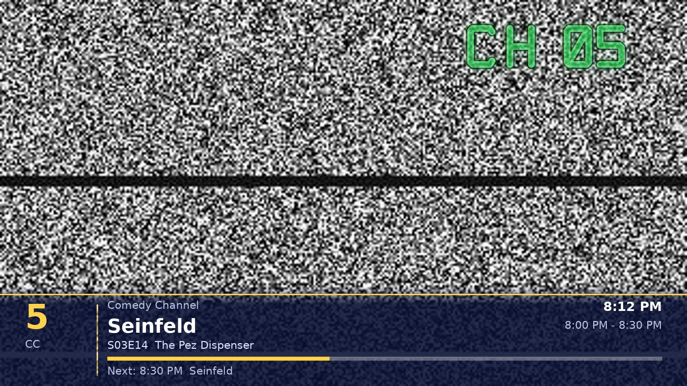
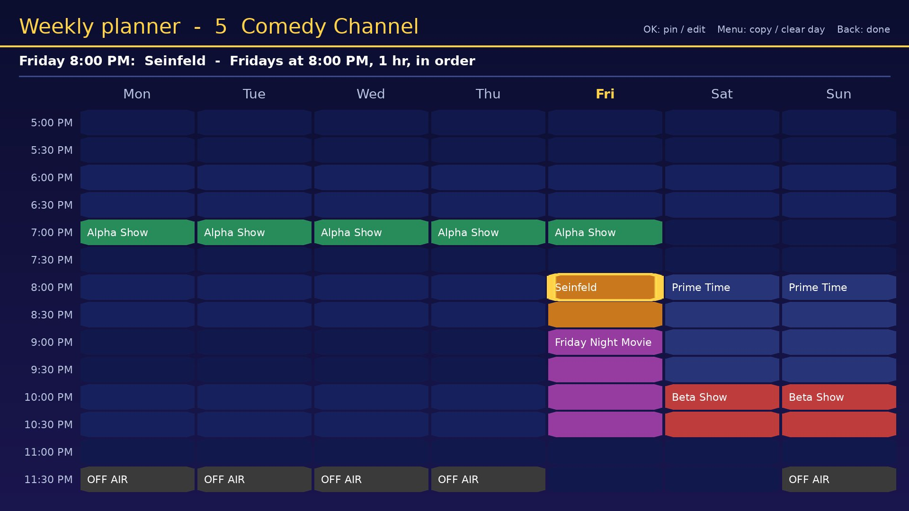
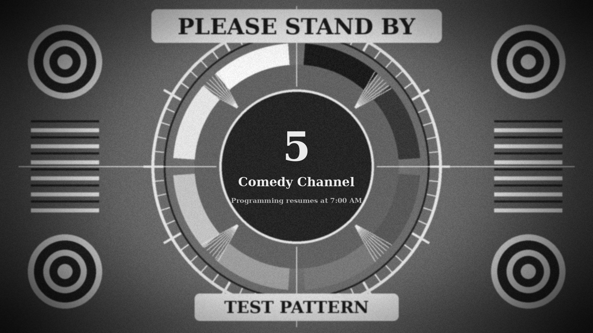
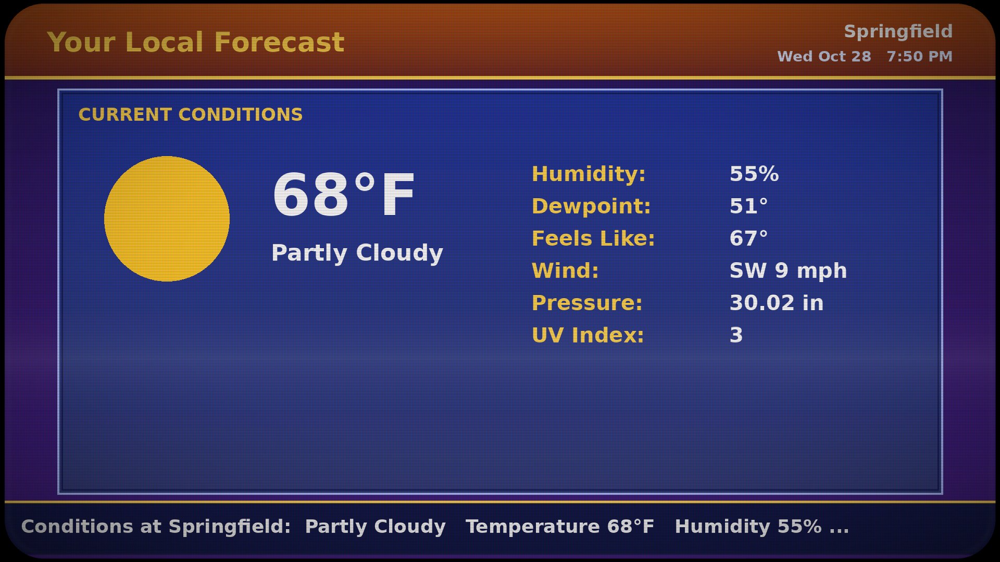

# CableBox 42

**Retro cable TV from your own Kodi library. Flip channels, not menus.**

> **Now in the official Kodi add-on repository** (Kodi 21 Omega). It's tested
> on CoreELEC (ODROID N2); reports from other devices are very welcome in the
> [support thread](https://forum.kodi.tv/showthread.php?tid=389521) or on
> [GitHub issues](https://github.com/SeadogMcGrog/script.cablebox42/issues).

CableBox 42 turns the movies and TV shows you already have in Kodi into a live
cable lineup. Shows air on a real clock with commercial breaks, bumpers and
station IDs. There's a scrolling program guide channel, a retro weather
channel, static between channels, a "CH 03" channel number, and a 1950s
*Please Stand By* card when a station signs off for the night. You pick up the
remote, flip to channel 5, and whatever is on is already halfway through.

It's inspired by [FieldStation42](https://github.com/shane-mason/FieldStation42),
but it's a separate implementation built for Kodi. It runs inside Kodi on
anything Kodi 21 runs on, and plays every file through Kodi's own player, so
hardware video decoding works exactly as it does for the rest of your library.

> **New to CableBox?** The **[How-To Guide](HOWTO.md)** walks through
> everything step by step: first lineup, station logos and clips, putting every
> show on the right channel, captions, the planner, and fix-it recipes.
> **What's new:** [changelog](changelog.txt) (1.1.0 adds station folders you can
> see and repair, *Shows without a good channel*, captions in the main menu, and
> more).

### ▶ See it in action

| Part 1: the tour | Part 2: guide and weather |
|---|---|
| [](https://youtu.be/38CTQFPLdgg) | [](https://youtu.be/VDaUOxNVePA) |
| *Channel surfing and commercials* | *The TV Guide channel and the Weather Channel* |

*Click a picture to watch on YouTube.*

1.1.0: turning on, flipping channels, turning off — <https://youtu.be/9Z8imCcMTeg>

| | |
|---|---|
|  |  |
| *Changing channel: static, "CH 05" and the channel banner* | *The weekly planner: pin shows to fixed times* |
|  |  |
| *Off the air: the stand-by test card* | *The weather channel with the Full CRT effect* |

*The screenshots are put together from CableBox 42's own screen artwork and layouts.*

---

## Contents

1. [Features](#features)
2. [Requirements](#requirements)
3. [Installing](#installing)
4. [Quick start](#quick-start)
5. [Watching TV](#watching-tv)
6. [How the schedule works](#how-the-schedule-works)
7. [Building and editing channels](#building-and-editing-channels)
8. [The weekly planner](#the-weekly-planner)
9. [Commercials, bumps, station IDs and sign-off clips](#commercials-bumps-station-ids-and-sign-off-clips)
10. [Off the air](#off-the-air)
11. [Holidays](#holidays)
12. [Stations and logos](#stations-and-logos)
13. [The guide channel](#the-guide-channel)
14. [The weather channel](#the-weather-channel)
15. [CRT effect](#crt-effect)
16. [Home screen, Favourites and phone remotes](#home-screen-favourites-and-phone-remotes)
17. [Settings reference](#settings-reference)
18. [Video formats and AV1](#video-formats-and-av1)
19. [Files and hand-editing](#files-and-hand-editing)
20. [Troubleshooting](#troubleshooting)
21. [Credits and license](#credits-and-license)

---

## Features

- **No schedule to compile.** Lineups build themselves from your library and
  extend themselves as time passes.
- **Real-time channels.** Programs start on the hour and half hour. The time
  left over in each slot is cut into commercial breaks, just like real cable.
- **Automatic lineup builder.** One step creates a guide channel, a weather
  channel, genre networks and movie channels, each one a built-in station with
  its own logo.
- **Weekly planner.** A 7-day grid for each channel. Pin shows to fixed times,
  for example *Seinfeld, Fridays 8 PM, in order*. Each pinned slot picks up
  where it left off the week before.
- **Holidays and specials.** A marathon or a holiday lineup on a date: a
  Turkey Day marathon, New Year's Eve from 6 PM, Christmas Day on three
  channels. Any date, any country's holidays, back every year by itself.
- **Time blocks.** Saturday-morning cartoons, prime-time movies, late-night
  blocks.
- **Off the air.** Sign-off hours with a 1950s stand-by card or colour bars
  (silent or with the 1 kHz tone), a "This concludes our broadcast day" card
  at sign-off, and optional sign-off and sign-on clips.
- **Commercials, bumps and station IDs** from your own folders.
- **Promos.** "Channel 7 — Seinfeld: \"The Contest\" — Up next", with the
  episode's still, the show's logo and its theme music, made from your own
  library (on by default).
- **Guide channel.** A Prevue-style grid that crawls up without stopping: call
  letters, titles with year, rating, *(CC)* and *(Stereo)*, colour-coded movies,
  sports and kids' shows, and cable-company ads.
- **Weather channel.** Current conditions, Latest Observations from nearby
  cities, a text forecast, a regional map, a 4-day outlook and the next few
  hours, with a ticker and optional background music.
- **The look of a CRT.** Static and a static sound between channels, a glowing
  green "CH 03" channel number, and an optional CRT effect: scanlines,
  curved-glass corners, a phosphor mask and a rolling hum bar.
- **Fine-tuning.** Move any show between channels, hide shows from a channel,
  and renumber channels with swap or slide.
- **Searchable pickers** for libraries with thousands of tags, studios or titles.
- **Works with your skin and your phone.** Home-menu widgets show what's on now,
  and you can tune from Yatse or Kore.
- **Safe on small boxes.** AV1 videos are skipped automatically on devices that
  can't decode them in hardware.

---

## Requirements

- **Kodi 21 "Omega"**, on any platform: Windows, macOS, Linux, Android,
  Android TV, Fire TV, LibreELEC, CoreELEC, OSMC or Raspberry Pi.
- **Your shows and movies scanned into the Kodi library.** CableBox reads
  titles, genres, years, studios, tags and running times from the library.
  Folders that aren't in the library can be used too; see *Programming sources*.
- **Optional:** folders of commercials, bumps, station IDs, sign-off and sign-on
  clips, and music for the guide and weather channels. You can collect these
  yourself; CableBox only ever plays files you have.

---

## Installing

**From the official Kodi repository** (recommended; updates arrive automatically):
*Add-ons → Install from repository → Kodi Add-on repository → Program add-ons → CableBox 42*.

**From a zip file** (for test builds, or Kodi without the official repository):

1. Download the latest `script.cablebox42-x.y.z.zip` from this repository's
   releases, or build one by zipping the `script.cablebox42` folder.
2. In Kodi: *Settings → System → Add-ons* → turn on **Unknown sources**.
3. *Settings → Add-ons → Install from zip file* → choose the zip.
4. CableBox 42 appears under *Add-ons → Program add-ons* and *Video add-ons*.

To update, install the newer zip over the top. Your channels, pinned shows and
settings are kept.

---

## Quick start

1. Open **CableBox 42**. The first time, a welcome screen asks how to start:
   **Build my lineup** (the steps below) or **I'll set it up myself** (you get
   just the TV Guide on 2 and a Weather Channel on 25, and the Channel manager
   opens so you can add your own channels).
2. CableBox looks through your Kodi library (about a minute) and says how many
   channels it found. If the library is empty it says so here, before asking
   anything.
3. Choose **Start watching**: the channels are set up with overnight sign-off
   (12 AM to 5 AM) and prime-time lineups, and the TV comes on. That's it.

The folders CableBox can use (commercials, bumps and station IDs, guide and
weather music, music videos) and your weather city are not asked for now. The
main menu shows **Finish setting up** until each is chosen or you say you
don't need it.

**Customise** instead of *Start watching* asks everything first:

- your commercials folder, how **bumpers and station IDs** work (**one folder
  for every channel**, **a folder for each channel**, or skip), music for the
  guide and weather channels, a music videos folder, your city;
- **Channel names**: **CableBox's stations** (Comedy Corner, Orbit TV... with
  their logos) or **Plain names, I'll brand them myself** (Comedy Channel,
  Sci-Fi Channel... the same shows on each, no logos; rename them and add
  your own logos in the Channel manager);
- which of the suggested channels to keep;
- **Extras**: *Sign off overnight* and *Prime-time lineup*, both ticked;
- a last screen with everything you chose. Nothing is saved before its **OK**:
  **Back** or **Cancel** on any screen leaves everything as it was. Then
  **Start watching**, or **What I set up** first.

To fine-tune, use the **Channel manager** (its **Lineup tools** have **Shows
without a good channel** and **Move shows between channels**) and the
**Weekly planner**. The [How-To Guide](HOWTO.md) walks through each of these.

---

## Watching TV

| Remote button | What it does |
|---|---|
| **CH+ / CH−**, **Up / Down**, **Page Up / Down** | Change channel, with a burst of static |
| **Number keys** | Go straight to a channel. "CH 1_" shows while you type |
| **Left** | Last channel (jump back and forth) |
| **Right** | "What's on now": every channel and its current show |
| **OK / Info** | Show or hide the channel banner (now, next, progress) |
| **Menu / Context** | **Closed captions** and caption options, what's on now, last channel, **sleep timer**, *Don't air this show here*, **CableBox menu** (channels and settings), turn off |
| **Subtitle / CC button** | Captions on or off (once *Settings → On screen → Remote CC button* is set up) |
| **Back / Stop** | Turn off the TV and go back to where you started it: the CableBox menu if you chose *Watch TV* there, otherwise Kodi |
| **Volume / Mute** | Work as normal |
| Pause, seek, skip | Ignored. It's live TV |

**The channel banner** slides up when you change channel. It shows the
channel number and call letters, the current show (with season, episode and
episode title), its time slot and progress, and what's on next.

**Names on screen** come from your library: on air, titles leave the year out
(*The Fugitive*, not *The Fugitive (1993)*), except for two shows that share a
name or a year that's part of the title. Commercials, bumps, station clips and
folder channels use the clip's NFO `<title>`, else the file name cleaned up (no
dots, release tags such as *720p* or *WEB-DL*, or file paths). Menus where you
pick things keep the years. NFOs are only read, never written.

**Leaving the TV.** Press Back to turn it off. If you switched it on from
CableBox's main menu, you're back in that menu (Back again goes to Kodi); from
a Kodi shortcut, a widget, or with *Skip the menu* on, you're back in Kodi.
To reach channels and settings from the TV, press Menu → **CableBox menu**:
the TV turns off and the main menu opens; *Watch TV* there turns it back on,
on the same channel, with your changes. If you press **Home** instead,
CableBox notices within a couple of seconds and switches itself off. It never
stops, replaces or interferes with videos you play yourself from the library.

**Your watch progress is left alone.** Kodi normally saves a resume point
and can mark an episode as watched whenever *anything* plays it, so channel
surfing would fill your "In progress" list. CableBox notes each show's
resume point, watched status and last-played date before airing it, and puts
them back afterwards (even after a crash or power cut). Turn this off in
*Settings → Start-up & library → Keep my watch progress untouched*. To tidy a list that
filled up before this protection existed, use **Clean up my 'In progress'
list** (*Settings → Start-up & library*): tick what you're really watching and the rest is
cleared.

**Sleep timer.** Menu → *Sleep timer* (15 minutes to 2 hours). There's an
optional setting to put the TV into standby through HDMI-CEC when it runs out.
When the sleep timer turns the TV off you're left in Kodi, never in a menu.

---

## How the schedule works

You don't build a schedule. Each channel keeps a rolling schedule, about
12 hours ahead by default, that extends itself:

- **When you tune in**, the channel's schedule is checked and topped up.
- **While you watch**, a background helper keeps every other channel ready,
  starting with the channels next to yours.
- **While the TV is off**, Kodi's background service tops up every channel
  every 20 minutes.

What airs when:

- **Programs start on a clock.** The default is :00 and :30, which you can
  change per channel to the hour, every 15 minutes, or no clock (back to back).
- **The leftover time becomes breaks.** A 22-minute sitcom in a 30-minute slot
  gets about 8 minutes of commercial breaks, spread through the show and at the
  end. Each break ends with a bump, and the last one ends with a station ID if
  the channel has them.
- **Series play in order.** Each show continues with its next episode.
- **Lineup style:**
  - *Same show same time every day*: weekdays get the same lineup each day, and
    each weekend day has its own.
  - *Shuffle*: picks change all the time.
- **Movies** don't get cut into by default. Commercials play between films
  instead.
- **Pinned shows** from the weekly planner always start on time. Automatic
  picks never run into them.
- **Specials** ([Holidays and specials](#holidays-and-specials)) come before
  everything else on their channel for their hours: pinned shows, off-air
  hours, the holiday seasons and summer reruns all wait until the special ends.
- **No commercials?** House breaks: short breaks of about a minute inside the
  show, made of the channel's own promos, promos for other channels' shows
  ("Tonight at 9:00 on Channel 6"), ads for the guide and weather channels and
  tonight's lineup, and made-up retro commercials, rounded off by a station ID. At the end of a slot, house
  breaks run back to back, then the *Up next* card (at most about a minute and a
  half) right before the next show. See *House breaks* below.

Changes apply from each channel's **next programme**, on their own: close
Settings, the Channel manager, the Weekly planner or a tool and CableBox
refreshes the schedules if anything they're planned from changed (channels,
pins, station clips, commercials, promo and break settings). What's on air keeps
playing, and every show stays on its next episode — wherever it moves. Picture,
sound and other device settings don't touch the schedules. While it works, a box
in the middle of the screen says *Updating your channels* and what it's doing;
the menu comes back when it's done. If nothing moves for a minute, *Cancel* gives
the screen back and a small bar in the corner shows the update until it ends.

**Your library too:** about 30 seconds after Kodi finishes scanning or cleaning
the video library, new episodes, movies and shows (on channels whose sources
cover them) are in the schedules from each channel's next programme, even with
the TV on. A scan that finds nothing changes nothing. A file the library still
lists after it was renamed or deleted is never planned (if the library has the
same episode under its new name, that one airs; kodi.log says *run Clean
library*). A planned file that has gone never means dead air: the rest of its
slot airs the same episode from another file the library has, or one stand-in
from the channel's own shows (the same one after each break and when you tune
back in), and the channel is planned again, the show going on with its next
episode. New shows no channel airs are
mentioned once in the CableBox menu (*OK* opens *Shows without a good channel*).

### One home channel per show

Like real cable, each TV show has **one home channel**: the channel it fits
best. In order of priority:

1. Your explicit choices: shows picked by name, or ticked in *Move shows
   between channels*.
2. Specific matches: a folder, a movie collection, a tag, a smart playlist, a
   studio.
3. The show's **network** (the station that stands in for it, below), or, for
   Korean and Chinese dramas, an original title in Korean or Chinese.
4. The show's **main genre**. Kodi lists genres most important first, so *Good
   Eats* (Documentary, Comedy) lands on the documentary channel.
5. Decade channels, if you made any.

A show whose genres are all too small for a channel of their own (a lone
western, say) goes on the biggest genre network, picked by name, so nothing in
your library is left off the air. Move it anywhere you like with *Move shows
between channels*.

A channel left with almost nothing is topped up with a few shows that suit it
nearly as well, so no channel runs the same two shows all day. Topping up never
takes a show away from the channel of its main genre or its network (lineups
built with *Build my lineup* from this version on; an older lineup keeps its
homes until you build it again). Your pinned
slots and time blocks always air what you put there.

**Never the same show on two channels at once.** Even when a show is
allowed on several channels (because you chose that, or with repeats
allowed), CableBox checks what every other channel is airing, including their
pinned slots, before it picks. Flipping from channel to channel, you won't land
on the same episode twice.

*Settings → Channels → Shows on more than one channel*:

| Option | Behaviour |
|---|---|
| **TV shows on one channel each** (default) | Movies can still repeat across movie channels, as on real cable (never at the same time) |
| **Everything on one channel each** | Movies too |
| **Allow repeats on any channel** | The old behaviour; still never at the same time |

---

## Building and editing channels

### Main menu

| Item | What it's for |
|---|---|
| **Watch TV** | Turn the TV on |
| **What's on now** | Every channel with the show airing right now. Pick one to tune straight to it |
| **Closed captions** | On or off for every programme (off until you switch them on) - the same setting as Menu → Closed captions while watching |
| **Finish setting up** | Only while something a first setup left for later isn't set: commercials, bumps and station IDs, guide and weather music, music videos, weather city. Each row leaves once it's chosen or you pick *I don't need this* |
| **Channel manager** | Add, edit, delete and renumber channels. Its **Lineup tools** work on the whole lineup (below) |
| **Weekly planner** | Open a channel's 7-day grid |
| **Holidays & events** | *Calendar* (specials on their days, the holiday seasons shaded), *Add a special*, *Holiday seasons (automatic)* ([Holidays and specials](#holidays-and-specials), [Edit the seasons](#edit-the-seasons)). The only place for them: *Settings → Holidays & events* holds just the options |
| **Settings and tools** | All settings, plus the maintenance **Tools** page below |
| **Help** | |

On first run, before you have channels, the menu offers **Build my lineup** instead.

### Channel manager → Lineup tools

Everything that works on the whole lineup rather than one channel.

| Tool | What it's for |
|---|---|
| **Build my lineup** | Create a lineup from your library: replace yours, or add to it. Channels it adds get overnight sign-off; channels you already have keep their own off-air hours |
| **Move shows between channels** | Pick a show or movie, then tick the channels it should air on. It airs exactly there |
| **Shows without a good channel** | See below |
| **Sign-off and prime time for all channels** | Overnight sign-off hours on or off, and prime-time lineups built or removed, with your choice of hours. If some channels already sign off at times of their own it asks: *Replace their hours* / *Only the others* / *Cancel* |
| **Station folders** | Makes what's missing of each channel's folder (bumps, ids, commercials, time blocks) - an existing folder is reused, never copied - then shows which folder every channel uses, what's in it, and folders no channel uses |
| **Lineup summary** | Every channel, where its shows come from, and its station folders |

### Settings → Tools

Maintenance jobs live on their own page in Settings, so the menu stays short.
Each button closes Settings and opens the tool; what you changed in Settings before
pressing it is saved, as with OK. In the order Settings shows them,
under *Schedules*, *Check* and *Reset*. *Holidays & events* is in the main menu (its options in
*Settings → Holidays & events*); *Remote CC button* is in *Settings → On screen*;
*Clean up my 'In progress' list* is in *Settings → Start-up & library*.

| Tool | What it's for |
|---|---|
| **Refresh schedules (keep my place)** | The same refresh CableBox does by itself when something changes: from each channel's next programme, what's on air keeps playing, every show keeps its next episode. No question asked |
| **Start series over…** | The only thing that sends shows back to their first episode: *All shows*, *One channel* (the shows it's home to, its own runs and pinned slots) or *One show*, then *Cancel* / *Start over* (Cancel has the focus) |
| **Check my videos** | Lists commercials, bumps and videos that can't be used, and why |
| **Check extras** | Every movie's `Extras` folder (next to the movie's file, or in `VIDEO_TS` / `BDMV`): each video's cleaned-up title, length and *Air* or *Skipped* with the reason, plus totals at the top. Making-of pieces, documentaries, featurettes, interviews and other readably named videos air; deleted/extended/alternate scenes, bloopers, trailers and promos, galleries, music videos, short films, commentaries, anything under a minute and names like `title_t03` are skipped. Everything in an `Extras` subfolder named *Behind the scenes*, *Making of*, *Interviews*, *Featurettes* or *Documentaries* airs. CableBox lists and measures these folders in the background while the TV is off and never changes them. The summary shows *Lengths measured: X of Y*; while some are still to do, **Look now** (*Look for movie extras*) does the rest straight away (progress bar, *Cancel* keeps what's found so far) and says how much there is to air when it finishes. After the list it offers to look for the rest, or to add a Behind the scenes channel when there's enough and you have none. Videos whose length can't be read don't air |
| **Check chapters** | *Chapters read: X of Y*, with *Read now* (Cancel keeps what's read). Every TV show with how many episodes have act breaks, scene chapters, automatic chapters or none, and how many aren't read yet. Pick a show for *Automatic* (default), *Always use chapters* or *Never use chapters*, or its episodes with where their breaks (and end credits) are |
| **Check skipped episodes** | The TV episodes the last refresh left out for being shorter than *Skip episodes shorter than*, by series, with their length and file. Nothing is moved or hidden in Kodi |
| **Start over (factory reset)** | Back to a fresh install: deletes channels, planner pins and schedules (optionally all settings too), then shows the welcome screen. Your videos, bumps, commercials and station folders are never touched. Handy for setting up the new stations cleanly |

### Shows without a good channel

*Channel manager → Lineup tools → Shows without a good channel*
lists TV shows that no channel's programming picks up, and shows whose home
channel is only a weak fit - a minor genre, a decade or catch-all channel, the
automatic list of shows whose genres were too small for a channel, or a show
moved so a small channel has enough to air. Each comes with its reason, for
example *Western (main genre) → Tumbleweed TV* or *No channel's programming
includes it*. Pick a show to put it on a channel (best fits listed first),
mark it as fine, or keep it off a channel or off the air. Your own picks are
never listed. (Movies are included when Settings → Channels gives every
movie one channel.)

### Lineup summary

Shown at the end of the lineup builder (*What I set up*) and any time from
*Channel manager → Lineup tools*: every channel with its station identity and where its programmes come
from, the station folders and what's in them, and where to go next.

### What the lineup builder creates

| Channel | Contents |
|---|---|
| 2 – TV Guide | The scrolling program guide |
| 3, 4, 5 – Keystone, Beacon, Horizon | Three broadcast networks with a real network day (below), when you have 12 or more TV shows |
| Genre networks | One per TV genre that a built-in station stands for (below) and that 5 or more shows would call home (their best fit, after the stations' networks), from channel 3 up. A genre with no station of its own (Talk, War & Politics…) gets no channel: make one yourself in the Channel manager. A genre that many shows list but few have first (Action & Adventure, often) gets no channel either; the log says so (*Action Channel: dropped, 2 shows would live here*). A small library with no genre that big gets one channel with every show instead |
| Station channels | A station whose networks or studios you have 5 or more titles from, even with no genre channel for it: Chameleon (Nickelodeon), The Dexter Channel (Disney), Red Thread TV… |
| Movie channels | Popcorn TV (every movie), Picture Show (before 1990) and The Exploration Channel (documentaries). No studio showcases or other movie-genre channels: add them yourself in the Channel manager |
| 25 – Weather Channel | Your local forecast |
| 42 – News 42 | When you have 5 or more news shows |
| Boombox TV | Music videos, when you have 30 or more ([Music videos](#music-videos)) |

### Broadcast networks

Channels 3, 4 and 5 are Keystone, Beacon and Horizon, which work like the old broadcast networks. Each one runs a
network day built from your library:

| Time | Block |
|---|---|
| Weekdays 6–9 AM | Morning news and talk |
| Weekdays 9 AM–noon | Game shows |
| Weekdays noon–3 PM | Soaps |
| Weekdays 3–5 PM | After-school cartoons |
| Every day 5–8 PM | Sitcom reruns |
| Every day 8–11 PM | Prime time: comedies and dramas, pinned to weekly slots if you chose a prime-time lineup |
| Every day 11 PM–midnight | Late-night talk shows |
| Saturdays 7 AM–noon | Saturday-morning cartoons |
| Sundays 1–5 PM | The Sunday movie |

A block only appears when you have shows for it (no soaps, no soap block);
a block that comes up short borrows something close (dramas for soaps,
sitcoms for late night). The three networks deal each block's shows out
between them like cards, so each has its own game shows, soaps and prime-time
lineup. The networks *share* shows with the cable channels - *Seinfeld* can be
a network hit in prime time and a rerun on Comedy Corner - but a show is
never on two channels at the same moment. Every block is an ordinary time
block, so you can change or remove it in the channel editor.

### Channel types

| Type | Behaviour |
|---|---|
| **Network** | Series and movies on a clock, with commercial breaks inside shows |
| **Movie channel** | Films on a clock, with commercials between them |
| **Loop** | Back to back, no clock, no breaks (good for cartoons, or music videos without the clock) |
| **Music videos** | Boombox: music videos on the real clock, like MTV in its day. Each half hour is a block of videos with commercial breaks between them, never in the middle of one, and the station ID in the last break. Each block plays videos of one frame rate only (23.976 with 24, 29.97 with 30, 25…), so the TV switches refresh rate only between blocks, inside a break; the frame rates take turns as often as you have videos of them. Never the same artist twice in a row, and no video comes round again until every video of its frame rate has played. The guide shows *Boombox Music Videos* with the block's artists. A caption in the lower left names the video shortly after it starts and again shortly before it ends: artist, "title", album, label, year, each line only when CableBox knows it (*Video captions* in the channel's settings turns it off). The channel's settings also have *Check music videos*: how many air, by frame rate, and what's skipped and why |
| **Music channel** | DMX-style audio channel: songs from your own music around the clock, with no breaks of any kind ([Music channels](#music-channels)). Only from *Add a channel*; *Build my lineup* never makes one |
| **Guide channel** | The program guide |
| **Weather channel** | The local forecast |
| **Behind the scenes** | Making-of pieces, documentaries and interviews from your movies' `Extras` folders, in per-film blocks ("Inside 2001: A Space Odyssey (1968)"). Every film with extras gets a turn before any comes round again, in a new order each time; a film gets up to an hour per turn (one longer documentary airs whole) and the rest of its extras continue on its next turn. Films with only a few minutes share a block, so a half hour is never mostly commercials. Breaks come only between segments, never in the middle of one. Named *BACKLOT* with its own logo by default; under another name CableBox asks whether to use the BACKLOT logo and corner bug. Adding a second one asks first. Its settings show *Movie extras: X h to air from N films* (opens *Check extras*). Until extras are found it shows *No programming*: **OK** there asks *Look for movie extras now?*; once CableBox has looked and found nothing to air, it points to *Check extras* instead. See *Check extras* for what airs In Kodi, turn **off** *Settings → Media → Library → Video library → Ignore video extras on scan* (on by default): while it's on, extras with their own `.nfo` are added as movies of their own and air on movie channels |

### Programming sources

A channel can draw from any mix of these:

| Source | Example |
|---|---|
| TV shows from your library | *Seinfeld, Frasier, Cheers* |
| A TV genre | *Comedy* |
| TV shows from a decade | *the 1980s* |
| Movies by genre, years and/or collection | *Horror, 1980–1989* |
| A folder of videos | Each sub-folder is a show, or play the files in random or set order. Works with network shares (SMB/NFS) and USB drives |
| A Kodi smart playlist | Anything Kodi's own rule editor can express |
| A studio or network: movies and shows | *Disney* (matches "Walt Disney Pictures", "Walt Disney Productions"…) |
| A Kodi tag: movies and shows | Tag things in Kodi (*Manage → Manage tags*), then build a channel from the tag |
| Anything whose title contains… | *Christmas* |
| Specific movies | Pick them from a list |
| Music videos | Kodi's music videos plus every other video in their folders, or a folder you choose ([Music videos](#music-videos)) |

Every long list, such as tags, studios, shows and movies, has a **Search…** row
at the top. Type a few letters to narrow it down. Lists where you can pick
several items keep your ticks across searches; press **Done** when finished
(Back asks whether to keep or discard your ticks).

### Channel options

Open a channel in the **Channel manager**. The editor has four groups, plus
*Preview today's schedule* (the next 12 hours) and *Delete channel*:

| Group | What's in it |
|---|---|
| **Identity** | Name, number (numbers can be **swapped** or **slid**, see below), call letters, logo (the row says where the logo comes from), **names by time of day**, its station folder, and *Use a built-in station...* / *Make this channel my own* |
| **Programming** | Type, the channel's sources, and **What's on this channel**: a checklist of every show and movie it airs. Untick what doesn't belong |
| **Breaks & clips** | The commercials, bumps and station IDs the channel really uses and where they come from (select *Commercials* or *Bumps* to switch them on or off; *Station IDs* to choose its own folder of "You're watching…" clips), *Break into shows for commercials*, **Ad flavour** (which retro ads its house breaks run: *Auto*, *General*, *Kids*, *Sports*, *Movies*, *Late night*), and the channel's own commercials and bumps folders |
| **Schedule** | **Weekly planner** (pinned shows, painted off-air hours), **Holidays and specials** (this channel's specials), time blocks (different programming at certain times, e.g. *Prime Time 8–11 PM: movies*), off-air hours (sign-off times, the off-air screen, sign-off and sign-on clips), lineup style (same show same time every day, or shuffle) and *Programs start on* (:00 and :30, the hour, every 15 minutes, or no clock) |

**Fine-tuning tips:**

- *Good Eats* landing on the Comedy Channel? Use *Lineup tools →* **Move shows
  between channels**, pick *Good Eats* and tick only the channels it belongs on.
- While watching: **Menu → Don't air '…' on this channel**.

**Renumbering:** give a channel a number that's already taken, and CableBox
offers to **swap** the two or **slide** the channels in between along by one.
For example, moving Weather from 24 to 3 pushes the old 3–23 up to 4–24.
*Channel manager → Rearrange channel numbers* can also close the gaps: channels
are numbered in order from a number you choose, and Weather stays on 25.
Renumbering never interrupts what's airing.

---

## Music videos

*Build my lineup* offers **Boombox TV** when it finds 30 or more music videos:

> Boombox TV — 210 music videos (136 from your library, 74 more in E:\Kodi\Music Videos)

Kodi's music video scraper only adds the songs it can match online, so CableBox also airs every other video in the folders your music videos are in. With no music videos in Kodi's library, the lineup builder asks for a folder instead (*Skip* leaves Boombox out). In the channel's settings, *Programming* can point it at a folder of your own (that replaces the automatic one) or add other sources.

**What the caption shows.** Each line comes from the first place that has it: Kodi's library, then the file's own tags (MKV and MP4 tags that many downloaders write: artist, title, album, label, date), then the file name read as **Artist - Title (Year)** (with a space on each side of the hyphen; the year is optional). A file named `a-ha - Take On Me (1985).mkv` shows artist, title and year; a name that doesn't follow the pattern still airs, with the file name as its title. CableBox looks nothing up online, writes no NFO files and never renames, moves or changes your videos.

**Skipped:** trailers and samples, anything under 30 seconds and videos with no audio track (*Check music videos* lists them, and so does Kodi's log). AV1 videos follow the AV1 setting.

**The first time:** CableBox reads each new video's length, frame rate and tags in the background (while the TV is off, or bit by bit while it's on), never on a channel change. Videos Kodi has scanned air straight away; the rest join once read: when the first ones are in, the channel takes them in from its next programme. *Check music videos* → *Read them now* does it at once.

## Music channels

Like the old DMX and Music Choice cable channels: songs from your own music, 24 hours a day, under a mostly still screen. *Build my lineup* never adds one (music taste is personal); make your own in **Channel manager → Add a channel → Music channel**, give it a name ("Hip-Hop & R&B") and pick where its songs come from. *Replace my lineup* keeps your music channels.

**Songs from:** a genre, a decade, an artist or an album of Kodi's music library, a music smart playlist, or a music folder, in any mix (*Add more* / *Done*). Without a music library only playlists and folders are offered. A channel needs at least 5 songs; songs under 30 seconds don't air.

**On air.** Songs play back to back on the real clock with no commercials, bumps, station IDs or promos, and they run across the hour freely. Tuning in joins the song on air at the right point. Never the same artist twice in a row, no song comes round again until every song on the channel has played, and each round is shuffled anew. Kodi moves from song to song by itself, gaplessly; its own music screen never opens and the screensaver stays off.

**The screen** (CableBox's own look, inside the 4:3 safe area): the station logo top left (from the channel's station folder or logo, else the channel name in large type), an info panel top right, a full-width bar with the channel name, and at the bottom the cover, **Artist**, "Title", Album (Year), a thin progress bar and *Coming up: Artist · Artist*. It changes only with simple fades: when the song changes, and when the info panel turns its page (every 20 seconds). Every 3 minutes the whole layout moves a few pixels so OLED and plasma sets don't burn in the logo and the bar.

**The info panel** is filled from what each song already has; nothing is looked up online. First the file's tags: album and year, *Track 3 of 11*, label, composer, genre and *Also on this album* (other songs of the album on this channel). Then, only when Kodi's music library has them, one artist fact (formed or born, years active, styles) and the first sentence of the artist's biography or the album's review (left out when it's too long to fit). A song without any of these shows less, never *Unknown*. A badly tagged file shows its file name read as **Artist - Title**.

**The guide** shows hour blocks named after the channel, with that hour's artists as the description.

**Channel editor** for a music channel: *Identity* (name, number, call letters, logo) and *Programming*: *Songs from* (add or remove sources), *Check songs* (how many songs and hours, the artists with the most songs, songs without an artist tag, sample rates), *Preview today's schedule* and *Delete channel*.

CableBox only reads your music: it never writes tags, NFOs or artwork and never changes your files or Kodi's library. Tags of files in a music folder that Kodi's library doesn't have are read as Kodi reads them and kept in `musicfiles.json` in CableBox's own data.

## The weekly planner

*Menu → Weekly planner* (or *Channel manager → a channel → Weekly planner*).

Monday to Sunday run across the screen and half-hours run down it. The line at
the top describes the slot under the cursor. Pinned shows are coloured, time
blocks are light blue, off-air hours are grey, and empty slots are filled
automatically.

| Button | Action |
|---|---|
| Arrows | Move around (the grid scrolls through the whole day) |
| **Right** past Sunday, **Left** past Monday | The next week, the week before |
| Page Up / Down, CH+ / CH− | Jump 7 hours |
| **OK** on an empty slot | *Pin a show here* or *Make off-air from here* |
| **OK** on a pinned show | Change the show, start time, length, days or order; rename; **start the series over from episode 1**; remove it from one day or every day |
| **OK** on a special's block | *Edit this special* (opens it, then comes back to the planner) |
| **Menu** | Copy a day's pins to other days, clear a day, off-air screen and clips, preview what airs next |
| Back | Done (changes are saved as you go) |

**Weeks.** The planner opens on this week; the title says *This week* or
*Week of 23 Nov*. Pinned shows, time blocks and off-air hours repeat, so they
look the same in every week. [Specials](#holidays-and-specials) belong to
dates: step to Thanksgiving week and the day's heading shows a ★ with the
special's name (or *2 specials*), and its hours are a gold block, on both days
when it runs past midnight. The pins under a special are not changed; they
just don't air during it. A past week is for looking only: OK and Menu say so.

**Pinning a show** asks four things:

1. **What:** any programming source (usually one show).
2. **How long:** *Match the show* (rounded up to the channel's slot), 30 minutes,
   1 hour, 90 minutes, 2 or 3 hours, or a custom length. If two episodes fit,
   two air back to back.
3. **Which days:** this day only, weekdays, every day, weekends, or pick days.
4. **Order:**
   - *In order*: the slot keeps its own place in the series, so Friday's
     Seinfeld continues week after week, whatever else the channel airs.
   - *Random*: any episode.

If a new pin overlaps an existing one, CableBox asks before replacing it on
the overlapping days.

**Automatic prime time.** *Channel manager → Lineup tools → Sign-off and prime time for all channels → Build prime-time lineups* (also
offered when you first build your lineup) fills 8–11 PM, or hours you choose,
with pins:
- **Network channels:** their best shows by your library's ratings, then the
  most episodes. Half-hour comedies come first and hour-long dramas later, each
  night has its own lineup, and each slot continues in order week to week.
- **Movie channels:** a *Movie at 8* every night.

These pins are labelled *(automatic prime time)* in the planner. Edit one and
it becomes yours, so rebuilding prime time later leaves it alone. Pins you made
yourself are never touched.

A show you pin can still air at other times through the channel's automatic
programming. To keep it to its pinned slot only, untick it in **What's on this
channel**.

---

## Commercials, bumps, station IDs and sign-off clips

All of these are ordinary video files in folders you choose: local drives,
USB disks or network shares.

| Kind | Where to set it | When it plays |
|---|---|---|
| **Commercials** | Settings → Breaks (global), or per channel | In breaks during and between programs |
| **Bumps** | Settings → Breaks (global), or per channel | At the end of each break ("…and now back to") |
| **Station IDs** | Per channel | Right before each new program ("You're watching…") |
| **Sign-off clips** | Per channel → Schedule → Off-air hours | When the channel signs off (anthem, farewell), instead of the built-in sign-off card |
| **Sign-on clips** | Per channel → Schedule → Off-air hours | When the channel comes back on the air |
| **Guide / weather music** | Settings | Behind the guide and weather channels |
| **Promos** | Station folder `promos/` (optional) | In breaks, with *Promos* on (see below) |

Tips:

- **A few dozen commercials of mixed lengths** (15, 30 and 60 seconds) fill
  breaks almost exactly. Clips longer than 10 minutes are ignored.
- CableBox reads each clip's length straight from the file, so no library scan
  is needed. It can read MP4, M4V, MOV, MKV, WebM, AVI, MPEG-TS, MPG, VOB, WMV
  and FLV.
- **Check my videos** lists clips whose length can't be read (remux them to
  .mp4 or .mkv) and AV1 clips your device can't decode.

### Promos

With *Settings → Breaks → Promos* on, a break can include a 15-second promo
for what this channel airs next (*Channel 7 — Seinfeld: "The Contest" — Up next*)
or later today (*Tonight at 8:00*).
Everything comes from your own
library, so promos always fit what's really on, and nothing is needed besides
your shows. CableBox only reads your files; it never changes them.

| Part | Where it comes from (first one found) |
|---|---|
| Picture | the episode's still (`-thumb.jpg`) → `fanart.jpg` → `landscape.jpg` → `poster.jpg` → the station background |
| Logo | `clearlogo.png` → the show's title in CableBox's own type (one or the other, never both). The logo loads while the spot before the promo plays; if it isn't ready when the card opens (say, the first time a show's promo airs), that card shows the title |
| Episode title | Kodi's library → the episode's `.nfo` (always shown) |
| Synopsis | the episode's outline (Kodi's library → its `.nfo` `<outline>`) if it fits in two lines → the first sentence of the episode's plot if the whole sentence fits → no synopsis line. Never shortened |
| When | One phrase: *Up next* for the channel's very next programme; otherwise *Today at 2:30*, *Tonight at 8:00* (from 5 PM), *Tomorrow at 7:00* or the weekday (*Saturday at 9:00*). A pinned slot with no episode details says *Weeknights at 8:00* (or *Weekends*, *Saturdays*…). The clock follows Kodi's region setting (12 or 24 hour) |
| Music | `theme.mp3` in the show's folder → a short built-in tune |

Kodi's own artwork and plot are used first; the files are the fallback. The
theme plays at its own level and stops when the card cuts to black; CableBox
never changes your volume. (The built-in tune is mixed a little below typical TV
loudness and fades out by itself.)

| Setting | Choices |
|---|---|
| Promos for what's coming up, in breaks | On (default) / Off. At most one per break |
| How often | Every break / About half the breaks / Now and then |
| Promote | Up next and later today (default): breaks inside a programme promote something later today on this channel (never the show you're watching, and not the same show twice in a row), the break before the next programme says *Up next* for it. On a movie channel, with breaks only between movies, that's always *Up next*. What's on next: always the next programme. Something later today: always a later show. Nothing later today to promote → the next programme |
| Look of promos and retro ads | Early-90s cable (default): a chunky magenta band slides in, the show's name lands in heavy italic letters (or its logo), the time drops into a yellow tab, squiggles and confetti pop in; all motion ends within 3 seconds and stays inside a 4:3 area. Modern: the sleek card |
| Music in promos and ads | The show's theme music / None (silent). Also house-break cards and retro ads, with Promos on or off |
| Also use short promo clips from a show's Extras folder | On (default). Videos in the show's `Extras` folder with *Promo* or *Trailer* in the name, up to 2 minutes, sometimes air instead (e.g. `Extras/1988 On-Air Season Two Promo.mkv`) |

### House breaks

*Settings → Breaks → House breaks* fills breaks with the cable system's own
spots, the way cable did, when you have no commercials. Nothing new to download:
everything comes from your library and CableBox's cards (same look as promos,
*Look of promos and retro ads* and *Music in promos and ads* apply).

| Choice | What happens |
|---|---|
| When there are no commercials | Channels without commercials get house breaks of about a minute at the usual break points; channels with commercials are unchanged |
| Mix in with commercials (default) | As above, and now and then one house ad inside a normal commercial break (at most one per break) |
| Off | No house breaks: without commercials a show plays straight through and the end of the slot shows *Up next* |

A house break has, in some order: a promo for this channel's own shows, promos
for shows on other channels (only what's really planned there, at that time), an
ad for the guide channel and the weather channel (only if you have them; weather
only with a location set), *Tonight's lineup* (what starts next on your channels),
then a station ID card. Never the same thing twice in one break, never the same
show promoted twice in a row. Your own commercials, bumps and promo clips always
come first.

**Squeezed credits:** at the end of an episode with chapters, the picture shrinks
into a window on the left and keeps playing with the show's own sound, while the
right side says what's up next with a live countdown, like the networks did in
the '90s. It starts at a credits chapter of its own (*Credits*, *End Credits*, or
a short last chapter after a short tag), or, where the tag and the credits share
one short last chapter (most disc rips), 30 seconds before the end (the whole
chapter if it's under 40 s): the tag keeps playing in the window, so nothing is
hidden. An episode without chapters (or whose chapters aren't read yet) squeezes
for its last 30 seconds if it's 15 minutes or longer. The break follows when the
file ends, as always. Not for movies, shorts, a last chapter over 3 minutes, a show
a pinned slot cuts off, or the last programme before the station signs off.

The **Up next card** at the end of a show says what comes next: its picture (the
episode's still or the show's fanart; a film's poster on a dimmed copy of itself;
else the channel's logo or number), its clear logo or title, *Season 2 · Episode 5*
or a film's year, rating and running time, the episode title and up to three lines
of its synopsis, the start time, the channel and a live **Starts in** countdown.
On Boombox it lists the block's artists. Titles, the channel and the artists are
never cut off: they shrink, then wrap. Its stripes drift and a glint crosses the
tab for as long as it's on.

The **station ID card** ("You're watching") shows the channel's logo, its number on
a red badge, its name on a gold band and the station's tagline (the built-in
stations each have one) along the bottom. A channel without a logo gets its name
in big letters in the logo's place and its tagline, or else its genre, on the band.
The card fills the last seconds of a break, so its rays turn slowly and a glint
crosses the band for as long as it's on, in both promo styles.

Channel names are never cut off, here or anywhere else (promo and house cards,
the guide, the standby and off-air screens): a long name gets smaller, then
takes two lines. A promo for another channel's show says *Name · Channel 6*, or
*Name · CH 6* when the name is long or already says Channel.

#### Retro ads

House breaks also run **retro ads**: made-up commercials from a cable channel
that never existed, as cards with a short jingle. Pitch cards (*Crisp-O-Matic*,
*only $19.99, order now!*), kids' toys and cereal, local businesses (*Big Earl's
Furniture Barn*), public service announcements (*Sit up straight*) and **Now on
videocassette** for a movie that really is in your library (its poster, title,
year and rating). *Settings → Breaks → House breaks → Retro ads*: on by
default; only used when house breaks are.

- They fit the **time of day** (breakfast cereal in the morning, pizza and cars
  in prime time, the diner and the late-night lawyers after 11), the **season**
  (tree lots and Earl's Black Friday blowout from mid-November, gyms in January,
  pools in summer, back-to-school in August) and the channel's **Ad flavour**
  (*Channel manager → channel → Ad flavour*). *Auto* picks *Movies* for movie
  channels, *Kids* for channels of children's genres, *Sports* for sports,
  otherwise *General*. A **Kids** channel only gets ads made for kids.
- **A long gap at the end of a show** (a short episode in a long slot) becomes a
  series of normal breaks of 2–3 minutes, the station ID card between them, and
  the *Up next* card at the end. Shorts packed into one slot get house breaks
  between them too.
- **Variety across the whole gap** (every break between two programmes): the
  same show is promoted at most once in 10 minutes and three times in all, and
  each system ad (guide, weather, tonight's lineup) runs once. When there's
  nothing fresh to promote, the slot gets a retro ad (up to ten in each of a long
  gap's breaks; the two-hour rule still holds), then a system ad, then the
  station ID card - never a repeated promo. Before off-air hours, the promo for
  the first show after them ("tomorrow at 5:00") runs at most twice: early in
  the gap and just before sign-off.
- **Two retro ads a break** (four on a *Movies* channel), and three in all of
  the back-to-back breaks at the end of a show (four on *Movies*); the rest of the break is promos,
  system ads and the station ID card.
- No ad twice in a break, the same ad not again on a channel within two hours,
  a running joke (Big Earl's sale) once per break. When every ad that fits has
  run, the break uses promos instead of repeating one.
- **Video rental ads** (*Now on videocassette*, Video Village, VideoVault): at
  most one a break and never in two breaks in a row on a channel (the
  back-to-back breaks at the end of a show count as one), and at most 1 in 6 of
  a channel's retro ads on *General* channels, 1 in 3 on *Movies*, 1 in 4 on the
  others. Past that, another ad that fits takes the slot.
- *Look of promos and retro ads* sets how cards come in (snappy or soft); *Music in promos and ads* off makes
  them silent. Your own commercials always win: retro ads are house-break content
  only, and with *Mix in with commercials* a normal break gets at most one house
  ad, retro or promo.
- Phone numbers are all 555-0100–0199; brands, places and people are made up.

**See one now:** *Settings → Breaks → Preview a promo*: pick a channel, then
*Up next* or a programme in the next 6 hours, and its promo plays full screen
exactly as in a break, between 2 s and 1 s of black (clean for a recording).

**Your own promos win:** video clips in a channel's station folder under
`promos/` are played instead of the automatic ones. Like other clips, new
promos and new settings apply from each channel's next programme once you close
Settings or the Channel manager.

---

## Off the air

Paint off-air hours in the **weekly planner** (OK → *Make off-air from here*)
or set them in *Channel manager → channel → Schedule → Off-air hours*. Each window has a
sign-off time, a sign-on time and the nights it applies to.

While a channel is off the air it shows either:

- **A 1950s "Please Stand By" test card**, with the channel number and name in
  the centre and "Programming resumes at 7:00 AM",
- **Colour bars** (silent), or
- **Colour bars with tone**: the same bars with a steady 1 kHz tone, like a
  real station after sign-off. It plays through Kodi's music player, so there's
  no refresh-rate switch, and stops as soon as programming resumes or you
  change channel.

As the channel goes off the air it signs off for about 25 seconds:

- **Built-in sign-off card** (the default): the station ID card's look, with
  "This concludes our broadcast day" and "We return at 7:00 AM". Silent.
- **A sign-off clip** of your own (anthem, farewell) from a folder you choose.
  If none of its clips fits the off-air hours, the built-in card plays instead.
- **None**: straight to the off-air screen.

Set it under *Off-air hours → Sign-off clip*. Tuning in after sign-off shows the
off-air screen, not the card. A **sign-on clip** plays just before programming
resumes. A show that's still running at sign-off time finishes first, as on
real TV.

---

## Holidays

CableBox follows the holiday calendar the way the networks did
(*Settings → Holidays & events*, on by default):

| Season | Run-up | All-out |
|---|---|---|
| **Halloween** | October 1–30, growing toward the end of the month | October 31, all day |
| **Thanksgiving** | – | Thanksgiving Day (fourth Thursday of November) |
| **Christmas** | Day after Thanksgiving to December 23, growing toward Christmas | December 24 and 25, all day |

- **In the run-up** a share of each channel's programmes are holiday ones,
  starting small and growing toward the day. Movie channels get more.
  *How much in the weeks before* sets the share: a little, some (default)
  or lots.
- **On the big days** every channel airs its holiday programmes all day, as
  long as it has any, then goes back to its usual shows. The automatic
  prime-time lineups step aside on those days. Slots you pinned yourself
  in the weekly planner still air.
- **Holiday programmes always come from the channel's own shows and movies**,
  so a kids' channel gets *It's the Great Pumpkin* rather than a slasher film,
  and a channel with nothing seasonal just carries on as normal.
- A holiday special won't repeat on any channel within 18 hours on the big
  days, or within a week during the run-up.
- **Holiday commercials and bumps:** each season can have its own folders.
  They play in every break on the big days and in a growing share of breaks
  during the run-up. Without them, the usual folders are used.
- **The rest of the year** (*Save holiday episodes and movies for their
  season*, on by default), Christmas and Thanksgiving episodes and movies, and
  anything that's explicitly Halloween, are kept out of the automatic schedule.
  Plain horror and monster shows still air all year. Slots you pinned yourself
  are never changed.

**What counts as holiday programming** (each season's page in *Holidays & events → Holiday seasons*):

1. **Kodi tags** on movies and TV shows: the main way. Any tag containing
   one of the season's words counts, whatever the capitalisation. With the
   default *halloween*, the tags *Halloween*, *Halloween Classics* and
   *kids-halloween* all count. Defaults: *halloween, spooky, horror* ·
   *thanksgiving* · *christmas, xmas, holiday*. In the editor you tick them
   from the tags your library really has.
2. **Kodi genres**: Horror for Halloween, and Christmas and
   Holiday for Christmas, by default. Untick them all to leave genres out.
3. **Titles, as a safety net.** Kodi can't tag a single episode, so episode
   and movie titles such as *Treehouse of Horror* or *A Charlie Brown
   Christmas* count too. *Extra title words* adds your own (*Festivus*); for
   Thanksgiving and Christmas they're also saved for the season, for Halloween
   (where only explicit Halloween material is held back) they aren't.

### Edit the seasons

Main menu → *Holidays & events → Holiday seasons (automatic)* lists each season with
its dates. Select one for its page; every change is kept as you make it, and the
schedules take it in from each channel's next programme when you leave the list.

| Row | What it does |
|---|---|
| On / Off | The season on its own (*Holiday programming* in Settings switches them all) |
| Name | Any name, any language (emptied: a built-in's own name again) |
| When | *Big days start*, picked like a special's date: a date, a weekday of a month, Easter ± days or a ready-made holiday, optionally moved by days. *Big days last* 1 to 14 days (past 31 December they carry on into January). *Run-up*: none, *some days before the big days*, or *starts on a date* (the same picker; its last date before the big days). Thanksgiving offers *US (4th Thursday of November)*, *Canada (2nd Monday of October)* or *My own rule* |
| How much in the run-up | *Same as Settings*, *A little*, *Some* or *Lots* for this season only |
| Tags / Genres | Ticked from a list of what's in your library (with *Search...*). A word that no tag in your library contains stays in the list, ticked, until you untick it |
| Extra title words | Typed, comma separated; added to the built-in list, never replacing it |
| Show what matches | For each channel, how many of its episodes and films count, and some titles |
| Commercials folder / Bumps folder | Optional, as before |
| Save its shows for its season | This season only; switching it on says how many episodes and films it will keep off the air the rest of the year |
| Reset to the built-in settings | Back to the shipped dates, words, tags, genres and folders |

**Any holiday, real or made up:** *+ Add a season...* at the bottom of the list
offers New Year's Day, Valentine's Day, St. Patrick's Day, Easter, May the 4th,
Towel Day, Canada Day, Independence Day, Bastille Day, Festivus and Boxing Day
(each with a few title words), or *My own date...*. Then how many big days, the
run-up, a name, and *Cancel* / *Add season*; its page opens, where you tick its
tags and genres. Your own season's page also has *Move up* / *Move down* and
*Delete this season*, and *Save its shows for its season* starts off (a broad tag
would otherwise hide shows for most of the year).

Holidays that follow another calendar (Diwali, Hanukkah, Eid, Lunar New Year,
Passover) take **Dates for each year...** in the date picker: you type each
year's date, and in a year with none the season simply doesn't run (*no date
for 2031* on its page). CableBox never works those calendars out itself. The
same picker is in *Add a special*, so a Diwali marathon works too.
Not supported: rules that repeat inside a year (every Friday the 13th).

Which season is on: a big day beats any run-up (Canada's Thanksgiving in
October beats Halloween's run-up), and between two big days the season higher
in the list wins (Thanksgiving, Halloween, Christmas, then yours in your order).
Between two run-ups, the holiday that comes first wins: Festivus's two days of
run-up air inside Christmas's. The changes live in `seasons.json` in CableBox's profile folder
(no file: the dates above); *Start over* removes it.

### Holidays and specials

The seasons above pick holiday programmes by themselves. A **special** is for
saying exactly what you want on a date: a marathon, a holiday lineup, a movie
night. *Holidays & events → Calendar* or *Add a special* in the main menu, or *Channel
manager → a channel → Schedule → Holidays and specials* for that channel's.

It opens on a **month calendar**. Days with a special show ★ and its name
(or *★ 2 specials*); today is outlined in white. A special that runs past
midnight marks its own date only. The holiday seasons are shaded: a season's
big days in red, its run-up in plum. The line under the grid says what the day
holds (*Christmas run-up (Some)*), and on a day with a special also what the
other channels do (*★ Turkey Day Marathon - 4 Keystone · other channels:
Thanksgiving: all day*). OK on a shaded day lists the season too; selecting it
opens that season's page.

Seasons and specials share **one list of holidays**: *When? → A holiday from my
list...* offers the built-ins and every holiday you added (Festivus, Diwali...)
with its name and date, then the ready-made dates. A special on a holiday's day
offers *Holiday episodes of this channel's shows* for that holiday (with the
tags, genres and title words you gave it), or of another holiday from the list.
A new season you add asks *Plan something for it too?*.

| Button | Action |
|---|---|
| Arrows | Move from day to day (past the edge: the next or previous month) |
| CH+ / CH−, Page Up / Down | Next month, previous month. Any year can be looked at. Holding the button never runs on: let go and it stops on that month |
| **OK** on a day | That day's specials (pick one to open it) and *Add a special on this day* |
| **Menu** | *Show as a list*: every special with its next date, soonest first. The list's last row, *Month calendar*, comes back. CableBox opens whichever you used last |
| Back | Done |

**Add a special on this day** already knows the date, so it skips *When?* and
only asks how it repeats: *On the 4th Thursday of November every year* (the
weekday rule, when the date fits one, so a Thanksgiving picked on the calendar
still floats; *Last Monday of May*, *Good Friday* and the like are offered the
same way), *On 26 November every year* or *This year only*. Then it carries on
with the name. Past days can be looked at, but not given a new special.

From the list, **Add a special** asks everything, one screen at a time (Back
on any of them adds nothing):

| Step | Choices |
|---|---|
| **When?** | *A date…* (31 December) · *A weekday of a month…* (4th Thursday of November, last Monday of May) · *Easter…* (Easter Sunday, Good Friday, Easter Monday, or any number of days before or after) · *A ready-made holiday…* (New Year's Day, Valentine's Day, Easter, Halloween, Thanksgiving (US), Christmas Eve, Christmas Day, New Year's Eve). Then *On the day itself*, *The day after*, *The day before* or *Move by days…* |
| **How often?** | *Every year* or *This year only* |
| **Name** | Filled in for you; change it if you like |
| **Which channel?** | One channel. *Add another channel* on the special's page adds more |
| **Which hours?** | *All day* (midnight to midnight) · *Broadcast day* (6 AM to 6 AM the next morning) · *Choose hours…* (an end earlier than the start means the next morning) |
| **What to air?** | Any programming source, as in the weekly planner. For Halloween, Thanksgiving and Christmas also *… episodes of this channel's shows*: the channel's own holiday episodes |
| **Episode order** | *Continue where last year's marathon stopped* · *From the first episode* · *Random*. A *This year only* special has no last year: *From the first episode* · *Random*. A single movie isn't asked |

The last screen sums it up: *Cancel* / *Add special*. The special's page opens
at once; the channels are planned again in the background.

A special's page has its name, date and repeat, each channel's programming
(OK: change the hours, what airs or the order, or remove the channel), *Add
another channel*, **Preview the day** (what will air, channel by channel) and
*Remove this special*.

- **Dates are rules.** *4th Thursday of November* and *Good Friday* are worked
  out again every year. 29 February skips the years without one; the list
  says *skips this year*.
- **On the day** the channel airs the special for its hours, with breaks,
  bumps and station IDs as usual. The guide shows its name after the title
  (*Seinfeld · Turkey Day Marathon*). A programme only starts if it ends by
  the special's end; a little time left over is a station break.
- **Movies in a special** are feature films: shorts (12 minutes or less, the
  ones a movie channel airs as *Short Subjects*) only fill time no feature
  fits, as on a movie channel. A short you picked by name (*Specific movies*)
  airs like any movie.
- **Holiday episodes** air once each on the day. When they've all aired, the
  rest of the special's hours are the channel's normal programming.
- **A marathon keeps its own place.** The show's regular run doesn't move
  while the marathon airs, and next year's marathon continues where this
  year's stopped (*Continue…*).
- **No show on two channels at once:** other channels leave a special's shows
  out of their automatic programming for its hours. A show *pinned* on another
  channel still airs there: pins always win on their own channel.
- **Saving asks when it matters:** another special on the same channel in
  those hours (*Cancel* / *Replace*); the same show in a special on another
  channel at the same time (*Cancel* / *Keep both*); its shows pinned on other
  channels during its hours, all in one question (*These shows are pinned on
  other channels during this special: Seinfeld on Beacon, Thu 8:00 PM; …*:
  *Cancel* / *Keep all*); holiday episodes that don't fill its hours (*Comedy 24
  has 3 Thanksgiving episodes (about 1½ hours) for 24 hours. The rest of the
  day will be its normal programming.*: *Cancel* / *OK*); a channel with no
  holiday episodes is told so, and airs its normal programming on the day.
- **A special for today** starts after the programme that's on now. Nothing
  on air is cut off.
- **Promos:** in the six days before, some of the channel's promos (and
  other channels' promos for it) name the special: *Thursday, all day*,
  *Tomorrow, all day*, *Tonight at 6:00 PM*. They follow the promo settings
  under [Promos](#promos); house breaks carry them too. Channels without a
  special of their own promote other channels' specials now and then, with or
  without house breaks.
- **This year only** specials leave the list once their date has passed.
- **Deleting a channel** asks first when it has specials, and takes its part
  in them with it. If a channel disappears another way (*Build my lineup →
  Replace*), its specials stay in the list as *channel removed* and air
  nowhere until you pick them and *Choose a channel* (or *Remove*).
- **In the weekly planner** a special shows in its own week: see
  [The weekly planner](#the-weekly-planner).

### Summer reruns

The 90s TV year had a shape: new episodes in the fall, then a summer of reruns.
With *Settings → Holidays & events → Summer reruns* on (*Broadcast networks* unless you change it), from
**1 June to 31 August** the channels air episodes of each series they've already shown instead of moving it on:

- A series reruns its current season in order, from its first episode up to the
  last one that aired, then round again. If fewer than three episodes of the
  current season have aired (say the next new one is an episode 1), it reruns the
  season before. A series with fewer than three episodes aired in all keeps airing
  new ones: there isn't enough to rerun.
- **In September each series carries on** with its next new episode, exactly where
  it stopped in May: the summer never moves a series on. Turning the setting off
  does the same at once.
- The guide and the banner show *(R)* after a rerun's title.
- *Broadcast networks*: the three networks on 3, 4 and 5 (Keystone, Beacon,
  Horizon). *All channels*: every show channel. Movie channels, Boombox, *Behind the
  scenes*, the guide and weather never rerun.
- Only the automatic schedule reruns. Slots you pinned in the weekly planner air as
  you set them, and pinned *in order* slots keep moving forward all summer.
- Holiday rules still apply to reruns (no Christmas episode in July).
- Schedules are planned hours ahead, so the switch shows in programmes planned after
  midnight on 1 June and 1 September; changing the setting replans from each
  channel's next programme.

Tagging a whole show (an anthology of Halloween specials, say) or a movie in
Kodi is the surest way to get it into the holiday lineup. Out of season, items
tagged with the holiday's own name (*halloween*, *thanksgiving*,
*christmas*/*xmas*) are held back; horror and mystery air all year.

## Stations and logos

CableBox comes with a set of made-up stations, each with its own logo. The
automatic setup gives them to matching channels:

| Station | Goes to | Through the day |
|---|---|---|
| **Keystone**, **Beacon**, **Horizon** | the three broadcast networks on 3, 4 and 5 | |
| **Retrocast Weather** | the weather channel, on **25** | |
| **Animation Station** | the cartoon (Animation) channel | |
| **Chameleon** | the kids' channel (Children, Kids or Family) | **CAM Jr.** 6 AM–noon · **Chameleon** · **Cam O Nite** 8 PM–6 AM |
| **The Dexter Channel** | the Family channel, and Disney's shows and movies | |
| **PES** | public educational TV: documentary series, plus anything you tag *educational* (or *PBS*, *public TV*) in Kodi | |
| **The Exploration Channel** | the documentary *movies* channel | |
| **Comedy Corner** | the Comedy (or Sitcom) channel | |
| **Curtain Call** | the Drama channel | |
| **Heartstrings TV** | the Soap channel | |
| **Red Thread TV** | Korean and Chinese (and Taiwanese) dramas, when you have 5 or more | |
| **High Octane TV** | the Action channel | |
| **Unscripted** | the Reality channel | |
| **Jackpot TV** | the Game Show channel | |
| **Siren TV** | the Crime channel | |
| **Whodunit** | the Mystery channel | |
| **Tumbleweed TV** | the Western channel | |
| **Popcorn TV** | the main Movie Channel | |
| **Picture Show** | the Classic Movies channel (before 1990) | |
| **News 42** | the News channel, on **42** | |
| **Orbit TV** | the Science Fiction channel (*Sci-Fi & Fantasy* too, so fantasy airs here) | |
| **Boombox TV** | the music video channel | |
| **BACKLOT** | the Behind the scenes channel (movie extras) | |

**Shows go where they first aired.** Kodi keeps a TV show's network in its
*Studio* field, and each station stands in for real networks, so a show's
network outranks its genre when CableBox picks its home channel:

| Station | Gets shows from |
|---|---|
| Chameleon | Nickelodeon, Nick Jr., Nicktoons, TeenNick, Noggin |
| PES | PBS, PBS Kids, Discovery, National Geographic, History, Smithsonian, Science Channel, Animal Planet |
| Animation Station | Cartoon Network, Adult Swim, Boomerang, Toonami |
| The Dexter Channel | Disney Channel, Disney Junior, Disney XD, Toon Disney, ABC Family; and every show or movie whose studio has *Disney* or *Pixar* in its name (Walt Disney Pictures, Disney+, Pixar), so Disney movies air here too |
| Comedy Corner | Comedy Central |
| Red Thread TV | Korea: KBS, MBC, SBS, tvN, JTBC, OCN, ENA, Channel A, MBN, TV Chosun, Mnet · China: CCTV, Hunan TV, Zhejiang TV, Dragon TV, Jiangsu TV, Beijing TV, Tencent Video, iQiyi, Youku, Mango TV, Bilibili · Taiwan: CTV, CTS, TTV, FTV, SET, GTV. Also any show whose *original title* is in Korean, or in Chinese characters (not Japanese), so dramas a streaming service made count too. Dramas only: never a show with Animation, Kids, Documentary, Reality, News or Talk among its genres |
| Keystone / Beacon / Horizon | NBC and the WB / CBS, UPN and the CW / ABC and FOX - their own shows lead their prime time, and stay on that network only |
| Others | Syfy (Orbit TV), Bravo, E! and TLC (Unscripted), GSN (Jackpot TV), CNN and MSNBC (News 42), Court TV and truTV (Siren TV), Lifetime and SOAPnet (Heartstrings TV), INSP (Tumbleweed TV) |

So *Rugrats* lands on Chameleon and *Mister Rogers' Neighborhood* on PES, even
though both are filed under Children. With 5 or more shows from a station's
networks, setup makes that station's channel even when no genre channel called
for it. Cable shows never air on the broadcast networks, and cartoons stay out
of their prime time. Names must match exactly ("NBC" doesn't catch "MSNBC").
A Kodi tag still outranks all of this: tag a show **educational** and it airs
on PES.

Channels without a station keep their plain names. Change any of it in
*Channel manager → channel → Identity*:

- **Station:** pick a built-in station, or **Make this channel my own**.
  A station is a brand (name, call letters, logo, time-of-day names) plus its
  shows. *Make this channel my own* takes only the brand away: the channel
  keeps its name (your rename, if you renamed it) and all of its programming.
  Choosing another station swaps the old station's brand and shows for the new
  one's; the question lists everything that changes. Programming and
  time-of-day names you added yourself always stay.
- **Name:** renaming a channel gives it new call letters (unless you typed
  your own) and, on a station with time-of-day names, asks whether to keep
  them (*CAM Jr.*, *Cam O Nite*) or remove them.
- **Names by time of day:** times when the channel goes by another name
  and logo, like CAM Jr. in the mornings. The banner, the corner logo and the
  guide switch over on their own.
- **Logo:** your own image.

### Your own stations folder

*Settings → Channels → Stations folder*: one folder per channel, named after
the channel's name, call letters or number. Everything inside is optional:

```
Stations/
  Chameleon/
    logo.png
    bumps/   ids/   commercials/        used all day
    CAM Jr./                            a time block's own folder
      logo.png   bumps/   ids/   commercials/
```

**Channel manager → Lineup tools → Station folders** makes this for every channel in one go,
with empty `bumps`, `ids` and `commercials` folders and a folder for each time
block, then lists which folder each channel uses and any folders no channel
uses (often a channel renamed since). Then just drop clips in.

A folder counts as a channel's when its name is the channel's name, its call
letters, or its number written as `7`, `Channel 7` or `CH 7` - exactly, ignoring
case and punctuation. A time block's folder may have more in front
(`Morning - CAM Jr.`). Renaming a channel offers to rename its folder too.

**Channel manager → a channel → Breaks & clips** shows what that channel
really uses right now - its logo, bumps, station IDs and commercials, each with
where it comes from (station folder, the channel's own folder, the shared one in
Settings, or the built-in station) and a warning when clips sit in a folder that
is switched off for the channel. It can make or repair the channel's folders,
browse them, or adopt an unused folder.

What's in the folder beats the built-in station, and a time block's folder
beats the channel's. A new logo shows within a couple of minutes; new clips are
used from each channel's next programme once you close the Channel manager (or
with *Settings → Tools → Refresh schedules*).

### The rating box

From 1997 every US show opened with a small black box in the top-left corner:
**TV** over the rating. CableBox shows it for the first 15 seconds of a show or
movie (also when you tune in within its first 10 seconds), with a **CC** box next
to it when the programme has captions (the same check as the CC button).

- The rating is the library's content rating (*MPAA* in Kodi's info). Shows keep
  their TV rating (*TV-Y*, *TV-Y7*, *TV-G*, *TV-PG*, *TV-14*, *TV-MA*); movies get the
  TV rating they'd have had on 90s TV: G → TV-G, PG → TV-PG, PG-13 → TV-14,
  R and NC-17 → TV-MA. *Rated PG-13*, *US:PG-13* and *PG-13* all work; no rating
  (or another country's), no box.
- Not after a break, not on commercials, bumps, promos, station IDs, the guide,
  weather, music videos or *Behind the scenes*.
- With the logo bug in the top-left corner, the box goes top right.
- Off: *Settings → On screen → Show rating at start of programmes*.

### The corner logo ("bug")

- It shows in a corner during programmes only, fading in a moment after the
  show starts. It stays off commercials, bumps, station IDs and the guide,
  like the real networks.
- Choose the corner (bottom right by default) and the opacity (50% by
  default) in *Settings → On screen*.
- In the channel banner, the logo replaces the call letters under the
  channel number.
- A plain **Logo folder** also works: images named after each channel's name,
  call letters or number (or after a time-of-day name, like `CAM Jr.png`).
  Any logo of your own beats a built-in station logo: the image you picked,
  then the station folder's, then the logo folder's.

Use PNG with a transparent background. Kodi can't show SVG, so convert SVG
logos to PNG first. Real network logos are trademarks, so use your own images.

## The guide channel

A grid of every channel with what's on now, in 30 minutes and in an hour, and
promos for upcoming movies and long programs. Press **OK** on the guide to pick
a channel. Add music under *Settings → Guide & Weather → Guide channel music folder*,
and change the title with *Guide title*.

The grid crawls up at a steady speed, the way the 90s preview channel did, and
never stops: after the last channel come a row with the guide's title and one to
three ads from the "cable company", then the first channel again. *Guide scroll
speed* sets the pace (Slow, Normal or Fast: about 3, 2.5 or 1.7 seconds a row).

- **Channels** show their number and call letters (*3 KEY*). A channel without
  call letters gets a short abbreviation of its name (at most 5 letters); the full
  name stays in the banner.
- **Listings** add what your library knows: movies get their year and rating
  (*The Fugitive (1993) PG-13*), and anything with a subtitle track, or a subtitle
  file next to it, gets *(CC)*; *(Stereo)* when the audio has two or more channels.
  A long title drops these details first, then gets a smaller font, then two lines;
  it's never cut off. The details are read from the library in the background just
  after the TV turns on, so they can appear a few seconds after the titles. Files
  are never opened for this.
- **Colours:** movies have a red cell, sports a green one and kids' programmes an
  amber one; everything else stays on the guide's blue. Sports and kids come from
  the library's genres (*Sport*, *Football*...; *Animation*, *Family*, *Children*,
  *Kids*); everything on a kids' channel (Ad flavour *Kids*, Chameleon, Animation
  Station) counts as kids.
- **Your own ads:** put a `guide.txt` in the guide channel's station folder, one ad
  per line (lines starting with `#` are skipped). They're used before the built-in
  ones. CableBox only reads the file.

Listings appear immediately. A channel whose listings are still being prepared
shows *Updating listings…* and fills in shortly afterwards.

---

## The weather channel

Pages rotate every 10 seconds:

- **Current conditions:** temperature, conditions, humidity, dew point, feels
  like, wind, pressure, UV index.
- **Latest observations:** the temperature and sky in 6-8 nearby cities of
  50,000 people or more (within about 300 km, further in empty areas), like the
  90s weather channel's "41 in Peoria, 38 in Springfield".
- **Local forecast:** an old-style TODAY… TONIGHT… TOMORROW… text forecast.
- **Regional map:** a drawn map around you (land, lakes, country and state
  borders) with the bigger cities nearby, their temperatures and sky icons. The map
  ships with CableBox (made from Natural Earth's public-domain maps) and works
  offline; only the temperatures come from Open-Meteo.
- **Extended forecast:** 4 days with icons, highs and lows.
- **The next few hours:** hourly temperatures and conditions, plus sunrise and
  sunset.

Times on the weather pages (sunrise, sunset, the hours, the day names) are the
forecast place's own local time; the clock at the top is your box's.

A ticker scrolls along the bottom of every page: current conditions, today's high
and low, and the forecast.

The observations and the map need to know where you are: a city typed in, or
(*Automatic*) the place Kodi's weather is set to. All the nearby cities come in one
Open-Meteo request, refreshed every 15 minutes. If it fails, the last temperatures
show (up to 6 hours old). With *Kodi weather service only*, or if there has never
been any data, the two pages are left out, never shown blank.

**Where the weather comes from** (*Settings → Guide & Weather*):

- **Automatic** (default): Kodi's own weather service if one is set up
  (*Settings → Services → Weather*), otherwise Open-Meteo.
- **Open-Meteo**: free, no account or key. Type a city (e.g. `Springfield, IL`) or
  `latitude,longitude`.
- Units follow Kodi's regional settings, or force °F or °C.

Add smooth jazz under *Weather channel music folder* for the full effect.

---

## CRT effect

*Settings → On screen → CRT effect*:

| Setting | What you get |
|---|---|
| **Off** | A clean modern picture |
| **Subtle** | Fine scanlines and gently darkened corners |
| **Full** | Adds curved-glass corners, a faint phosphor stripe mask, and a slow rolling hum bar |

The effect is a set of transparent layers drawn over the picture. The video
itself isn't processed, so it stays light even on small boxes, and hardware
decoding is unaffected. The only ongoing cost is the moving hum bar, which
makes Kodi redraw its interface every frame. If you'd rather avoid that, use
Subtle.

The green **CH 03** channel number always has its own CRT styling: glow,
colour fringing, scanlines and a faint flicker.

---

## Home screen, Favourites and phone remotes

**Launching:**

- **Favourites:** on CableBox 42 in Add-ons, open the context menu → *Add to
  favourites*.
- **Skins with a customisable main menu** (Arctic Zephyr, Aeon Nox, Titan,
  Bello… via Skin Shortcuts): add a menu item with one of these actions.

| Action | Opens |
|---|---|
| `RunScript(script.cablebox42)` | The CableBox menu |
| `RunScript(script.cablebox42,watch)` | The TV, on the last channel |
| `RunScript(script.cablebox42,watch,5)` | The TV, on channel 5 |
| `RunScript(script.cablebox42,wizard)` | The lineup builder |

- **Appliance mode:** *Settings → Start-up & library → Turn the TV on when Kodi starts*.
  Combine it with *Go straight to TV when opened*.

**Home-screen widgets.** If your skin lets you put CableBox 42 on the home
menu and shows a preview widget of that item's content, the widget becomes a
**"what's on now" channel list**. Selecting a channel turns the TV on at that
channel.

**Phone remotes.** Yatse, Kore and other Kodi remotes work as CableBox remotes.
The channel and number buttons map to standard Kodi buttons. Browsing CableBox
42 from a remote's add-on section should show the same channel list, so you can
tap to tune. Yatse custom commands can call the `RunScript` actions above.

---

## Settings reference

Each category is in the order Settings shows it, under the same headings.

**Breaks**

| Setting | Default | |
|---|---|---|
| *Commercials and bumps* | | |
| Commercials folder | – | Global commercials |
| Bumps folder | – | Global bumps (station IDs are per channel: its station folder's `ids/` or its own folder) |
| Commercial breaks per half hour | 2 | 0–4 |
| Commercial breaks at chapter marks | On | An episode with good chapter marks gets its commercial breaks where the original broadcast's act breaks were (Seinfeld's "The Opposite": after the cold open, at 13:27 and before the end tag). Chapters are read once per file, in the background: whenever Kodi is idle, as fast as the drive answers quickly (it slows down at once for a busy or waking drive, and pauses on a busy CPU); with the TV on, the episodes airing in the next 6 hours first, gently; never while you watch something else in Kodi. The episodes they change are planned again. *Chapters read* below the setting shows how far it is; until then, and for files without usable chapters (none, one, evenly spaced automatic ones), breaks are evenly spaced as before. Scene chapters every couple of minutes keep the usual number of breaks, each moved to the nearest mark. The leftover time decides how many breaks there are (at least a minute each). *Tools → Check chapters* shows each show's episodes and lets you set a show to *Always* or *Never* use chapters. Files are only read, never changed |
| *House breaks and retro ads* | | |
| House breaks | Mix in with commercials | See [House breaks](#house-breaks) |
| Retro ads | On | Period ads in house breaks ([Retro ads](#retro-ads)). Greyed when House breaks is Off |
| Look of promos and retro ads | Early-90s cable | Or Modern. Used by promos, house breaks and the era of the retro ads |
| Music in promos and ads | The show's theme music | Or none (silent). Also the jingles of house-break cards and retro ads, so it works with Promos off too |
| *Promos* | | |
| Promos for what's coming up, in breaks | On | At most one per break ([Promos](#promos)) |
| How often | About half the breaks | Every break / About half the breaks / Now and then |
| Promote | Up next and later today | Or only what's on next, or only something later today |
| Also use short promo clips from a show's Extras folder | On | *Promo* / *Trailer* videos up to 2 minutes |
| Preview a promo... | | Pick a channel, then *Up next* or *Later today* (its programmes in the next 6 hours): about 2 s of black, the promo exactly as in a break, 1 s of black, then Settings again. Changes nothing (schedules, breaks, series, *How often*). Back ends it. Works with Promos off. Also `RunScript(script.cablebox42,preview_promo,<tvshowid>)` for a skin button or a favourite. Not while the TV is on |

**Channels**

| Setting | Default | |
|---|---|---|
| *What airs where* | | |
| Shows on more than one channel | TV shows on one channel each | Or everything on one channel each, or allow repeats |
| Short programmes (under 12 min) | Pack several into one time slot | Back-to-back like a cartoon block (next episodes of the same series, or several short films), a break after each. Or *only where I pinned them* (skipped by the automatic schedule while anything longer is available), or *one per time slot* |
| Skip episodes shorter than | 5 min | Off, 2, 5 or 10 min. A TV episode shorter than this (an intro, trailer or recap filed as an episode) is passed over and its series goes on to the next real episode. Not for series whose usual episode is that short (7-minute cartoons still air, packed), not for episodes of unknown length, never movies, short films, music videos or extras, and a pinned slot airs what you pinned. Files are never moved or hidden. *Tools → Check skipped episodes* lists them |
| *Folders* | | |
| Stations folder (one folder per channel) | – | Each channel's folder holds its logo, bumps, ids, commercials, and time-block subfolders (see [Stations and logos](#stations-and-logos)) |
| Logo folder (images named like the channel) | – | Images named after each channel's name, call letters or number. Beats a built-in station logo |

**On screen**

| Setting | Default | |
|---|---|---|
| *Banner, logo and rating* | | |
| Show channel banner for | 6 s | 3, 6 or 10 seconds |
| Show the logo in the channel banner | On | Replaces the call letters |
| Station logo in the corner during programmes | On | Only shows when a channel has a logo |
| Corner / Logo opacity | Bottom right / 50% | Greyed when the corner logo is off |
| Show rating at start of programmes | On | The 1997-style *TV-PG* box in the top-left corner for the first 15 seconds of a show or movie (top right when the station logo is top left), with a *CC* box beside it when it has captions ([The rating box](#the-rating-box)) |
| *Changing channels* | | |
| TV turn-on and turn-off effect | On | Switching on: the picture warms up from a bright line, the CableBox 42 title card, then your channel - press any button to skip it. Switching off (Back, *Turn off* or the sleep timer): the picture shrinks to a dot - as a short clip on Windows, drawn over the picture elsewhere (a new video would make a TV that switches refresh rate blank out). Both with sound |
| Static between channels / Static sound | On / On | |
| Static plays as | Automatic | *Quick*: Kodi interface sound over the picture, the fastest. *Video clip*: a short static clip with its own sound, slightly slower but picture and sound always match. *Automatic* uses the clip on Windows, which drops interface sounds between videos, unless *Adjust display refresh rate* is on. |
| *Picture* | | |
| CRT effect | Off | Off / Subtle / Full |
| *Captions* | | |
| Remote CC button... | | Lets the remote's subtitle button switch CableBox's captions, or undoes it |

**Guide & Weather**

| Setting | Default | |
|---|---|---|
| Guide title | *CableBox 42 Program Guide* | |
| Guide channel music folder | – | Music behind the guide |
| Guide scroll speed | Normal | Slow / Normal / Fast ([The guide channel](#the-guide-channel)) |
| Weather data from | Automatic | Automatic / Kodi weather service only / Open-Meteo only |
| City or lat,lon | – | For Open-Meteo |
| Units | Automatic | Automatic / Fahrenheit / Celsius |
| Weather channel title | *Your Local Forecast* | |
| Weather channel music folder | – | |

**Holidays & events** (see [Holidays](#holidays); the calendar, specials and each season's page are in the main menu's *Holidays & events*)

| Setting | Default | |
|---|---|---|
| *Automatic holidays* | | |
| Holiday programming (automatic) | On | Every holiday season. Off greys the two rows below |
| How much in the weeks before | Some | A little / Some / Lots |
| Save holiday episodes and movies for their season | On | Keeps Christmas episodes out of July (the three built-in seasons; each can differ in its own page) |
| *Summer* | | |
| Summer reruns (June to August) | Broadcast networks | *Off*, *Broadcast networks* or *All channels*: June to August, series rerun episodes already shown ([Summer reruns](#summer-reruns)) |

**Start-up & library**

| Setting | Default | |
|---|---|---|
| *Start-up* | | |
| Start on channel | 0 | 0 means the last channel watched (so does a number no channel has) |
| Go straight to TV when opened | Off | Skip the CableBox menu |
| Turn the TV on when Kodi starts | Off | Only right after Kodi starts, and never if you've already started watching something else |
| *Sleep* | | |
| Sleep timer also puts the TV in standby (CEC) | Off | |
| *Your Kodi library* | | |
| Keep my watch progress untouched | On | Puts back resume points, watched status and last-played dates after CableBox plays something |
| Clean up my 'In progress' list... | | Clears resume points left by channel surfing. You keep the ones you tick |

**Tools**: maintenance only, see [Settings → Tools](#settings--tools). Lineup tools are in the
[Channel manager](#channel-manager--lineup-tools).

**Advanced**

| Setting | |
|---|---|
| *Scheduling* | |
| Schedule ahead (hours) | 6, 12 or 24. Default: 12 |
| Also air extras with unrecognised names | Movie extras named like `title_t03.mkv` or "Bonus 2" count too (see *Check extras*). Default: off |
| *Playback and captions* | |
| AV1 videos | Automatic / Always skip / Always play (see below). Default: Automatic |
| Captions: use Kodi's full-screen player | Shows programmes with captions in Kodi's own full-screen player; needed on most TV boxes. Default: on |
| Captions: rewind 1 second (embedded subtitles) | Makes Kodi show embedded subtitles on CoreELEC. Automatic (CoreELEC only) / Always / Never. Default: Automatic |
| *Developer* | |
| Developer tools | 0 0 0 while watching airs the channel's next promo at once (nothing in the schedule changes). Default: off |

## Video formats and AV1

CableBox plays whatever Kodi can play, using Kodi's own player and your
device's hardware decoding.

**AV1** is the exception worth knowing about. Many devices (for example the
ODROID N2, Raspberry Pi 4 and older Android TV boxes) can't decode AV1 in
hardware. Kodi then falls back to the CPU, which can stutter, freeze or crash.
Videos downloaded from YouTube are very often AV1.

- With *AV1 videos: Automatic*, CableBox asks the Amlogic video driver (on
  CoreELEC) whether it can decode AV1, and **skips AV1 files** if it can't.
  Other devices are assumed to cope; choose **Always skip** if yours doesn't.
- The codec comes from Kodi's library information or, for folders and clips,
  from the file's headers.
- **Check my videos** lists every AV1 file being skipped, per channel and per
  clip folder. Re-encode them to H.264 or H.265 to use them.

---

## Files and hand-editing

Everything lives in the add-on's data folder,
`userdata/addon_data/script.cablebox42/` inside Kodi's data folder:

| System | Kodi data folder |
|---|---|
| LibreELEC / CoreELEC | `/storage/.kodi/` (network share: *Userdata*) |
| Windows | `%APPDATA%\Kodi\` |
| macOS | `~/Library/Application Support/Kodi/` |
| Linux / OSMC / Raspberry Pi OS | `~/.kodi/` |
| Android | `Android/data/org.xbmc.kodi/files/.kodi/` |

| File | Contents |
|---|---|
| `channels.json` | Your lineup: channels, sources, pinned shows, time blocks, off-air hours |
| `calendar.json` | Holidays and specials: each special's date rule, channels, hours and programming. No file until you add one |
| `schedules/<id>.json` | Each channel's rolling schedule and episode bookmarks (rebuilt automatically) |
| `durations.json`, `codecs.json` | Cached running times and video codecs of files |
| `musicvideos.json` | What CableBox read from each music video: length, frame rate, audio track, tags |
| `state.json` | Last channel watched, weather location lookup |

**Example channel in `channels.json`:**

```json
{
  "id": "a1b2c3d4", "number": 5, "name": "Comedy Channel", "callsign": "CC",
  "type": "network", "slot": 30, "lineup": "strip",
  "commercials": true, "midroll": true, "bumps": true,
  "sources": [{"type": "tvgenre", "value": "Comedy"}],
  "exclude": ["Good Eats"],
  "slots": [
    {"id": "r1", "label": "Seinfeld", "days": [4], "start": "20:00", "minutes": 60,
     "order": "inorder", "sources": [{"type": "tvshow", "value": ["Seinfeld"]}]}
  ],
  "dayparts": [
    {"label": "Prime Time", "start": "20:00", "end": "23:00", "days": "weekends",
     "sources": [{"type": "movies", "genre": "Comedy"}]}
  ],
  "offair": [{"start": "00:00", "end": "07:00", "days": "all"}],
  "offair_style": "standby",
  "ids_path": "smb://nas/tv/station-ids/comedy/",
  "signoff_mode": "folder",
  "signoff_path": "smb://nas/tv/signoff/",
  "commercials_path": "smb://nas/tv/ads/80s/"
}
```

- **Days** can be `"all"`, `"weekdays"`, `"weekends"`, or a list of numbers
  (0 = Monday … 6 = Sunday).
- **Off-air:** `offair_style` is `"standby"`, `"bars"` or `"bars_tone"`;
  `signoff_mode` is `"card"` (the built-in sign-off card, the default),
  `"none"` or `"folder"` (a clip from `signoff_path`; a channel with only a
  `signoff_path` counts as `"folder"`).
- **Source types:** `tvshow`, `tvgenre`, `tvdecade`, `movies` (with `genre`,
  `years`, `set`, `tag`), `folder` (with `path` and `mode`: `shows`, `random`
  or `sequential`), `playlist`, `studio`, `tag`, `keyword`, `movie`.
- **Studio, tag and keyword** sources take `"what"`: `both`, `tv` or `movies`.

After editing by hand, use *Settings → Tools →* **Refresh schedules (keep my place)**.
Keep a copy of the original first.

---

## Troubleshooting

**A channel shows "No programming."** Its sources found nothing. Check that
your media is scanned into the Kodi library, then check the channel's
*Programming*.

**A channel shows "Technical difficulties."** A file wouldn't play: it may be
missing, or on a network share that's offline. CableBox moves on when the next
item starts.

**"Technical difficulties", then a different show.** Kodi couldn't open the
scheduled video (a damaged file, or one it can't read). CableBox shows the
card for a few seconds, then fills the time with another show from the same
channel, picking up after each commercial break. The file is kept off the
schedule for 3 days, then tried again. *Settings → Tools → Check my videos*
lists these files and can put them back on right away once they're fixed. If a
whole drive or share is offline, its files are not taken off the schedule.

**Breaks show "Up next" cards instead of commercials.** No commercials folder
is set, or none of its clips could be read. Run **Check my videos**.

**A video plays sound but no picture, or Kodi freezes or crashes on certain
videos.** It's very likely AV1 on a device without AV1 hardware decoding. See
[Video formats and AV1](#video-formats-and-av1).

**The CableBox menu opens by itself at startup or after a movie.** Update to
the latest version. Early test builds didn't understand the content requests
that some skins make for add-ons placed on their home menu.

**Frozen picture and no sound after a DTS programme (also in Kodi afterwards).**
Kodi 21 can misread the first frame of a DTS / DTS-HD track opened partway in, and
then can't open the sound output again until it restarts (passthrough on). CableBox
opens DTS programmes at the start and jumps to the position, which avoids it; if
Kodi's sound gets stuck anyway, CableBox restarts Kodi and comes back on the same
channel (TV on) or asks first (TV off).

**No static sound when changing channel, or only the first time.** Some
systems, Windows especially, reset their audio output between videos and drop
Kodi's interface sounds. Set *Settings → On screen → Static plays as* to
**Video clip**. With *Quick*, CableBox handles Kodi's *Play GUI sounds* setting
itself while the TV is on: button clicks stay silent during shows, the static
still plays, and your own setting comes back when you turn the TV off. Avoid *Video clip* if your TV switches refresh rate
for each video (*Adjust display refresh rate*), because it would blank the
screen briefly on every change.

**The guide says "Updating listings…"** That's normal right after installing or
updating. Listings appear within a minute or two as each channel is prepared.

**Pinned shows don't appear yet.** Changes apply from each channel's next
programme. Open *Preview today's schedule*, or use *Refresh schedules*.

**Getting a log for a bug report:**

1. Turn on *Settings → System → Logging → Enable debug logging*.
2. Reproduce the problem.
3. Upload the log and copy the link:
   - **CoreELEC / LibreELEC:** over SSH, run `pastekodi`.
   - **Anything else:** the **Kodi Logfile Uploader** add-on (*Program
     add-ons* in the Kodi repository), or paste `kodi.log` at
     <https://paste.kodi.tv/>.
   - If Kodi restarted, upload `kodi.old.log` (the log from before the restart).

CableBox's lines are tagged `script.cablebox42`.

**[Report a problem on GitHub Discussions](https://github.com/SeadogMcGrog/script.cablebox42/discussions/new?category=bug-reports)**
— a short form asks for your CableBox and Kodi versions, your device, what
happened, and the log link. Questions and chat are welcome in the
[Kodi forum support thread](https://forum.kodi.tv/showthread.php?tid=389521),
and ideas in [Discussions → Ideas](https://github.com/SeadogMcGrog/script.cablebox42/discussions/new?category=ideas).

---

## Credits and license

The fictional station logos in `resources/stations` were made with an AI image
generator and are released under [CC0](https://creativecommons.org/publicdomain/zero/1.0/)
(public domain): use them however you like. See `resources/stations/LICENSE.txt`.

The BACKLOT logo and corner bug (`resources/stations/backlot.png`,
`backlot_bug.png`) are original artwork made with Gemini, Google's AI image
generator, for CableBox 42, and are also released under CC0.

CableBox 42 is designed, tested and maintained by **Seadog McGrog**. Much of
the code was written with the help of [Claude](https://www.anthropic.com/claude),
an AI assistant made by Anthropic. Anthropic is not affiliated with this project
and has not reviewed or endorsed it.

Inspired by [FieldStation42](https://github.com/shane-mason/FieldStation42) by
Shane Mason, which pioneered this channel-flipping way of watching your own
media. CableBox 42 is a separate implementation for Kodi and contains no
FieldStation42 code. It is not affiliated with that project.

All artwork in this add-on (test card, channel digits, backgrounds, CRT
overlays, the 90s promo bands and shapes) is original. CableBox 42 plays only media you provide.

The retro ads' backgrounds and jingles are original: drawn and synthesized from
scratch by the scripts in `tools/retro-ads/` (`make_bg.py`, `make_station_layers.py`, `make_jingle.py`; no
photos, samples or outside art), released under MPL-2.0 like the rest of the add-on.
Their lettering is pictures of letters from the **DejaVu** fonts (Bitstream Vera
license and public domain), made by `tools/retro-ads/make_glyphs.py`. See
`resources/skins/Default/media/retroads/LICENSE.txt`.

The 90s promo lettering is pictures of letters from **Bebas Neue** by Dharma Type,
licensed under the [SIL Open Font License 1.1](https://openfontlicense.org); the promo
shapes are CC0. See `resources/skins/Default/media/promo90s/LICENSE.txt`.

Licensed under the **Mozilla Public License 2.0**; see [LICENSE.txt](LICENSE.txt).
